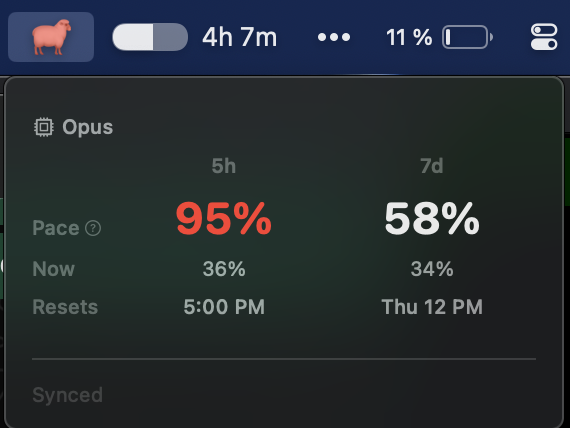
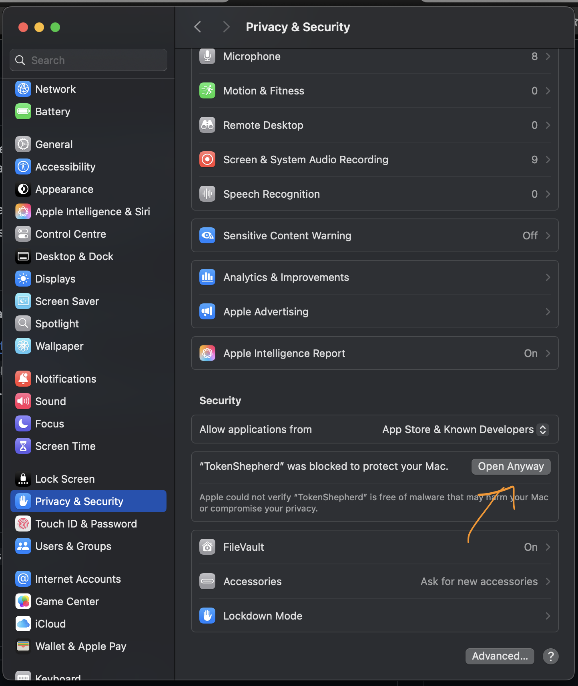

#  TokenShepherd

I kept getting rate-limited on Claude Code without warning. So I built this.

TokenShepherd sits in your Mac menu bar and watches your Claude Code quota. It projects where you'll be at reset and tells you *before* you hit the limit — not after.

<p align="center">
  
</p>

## The Sheep

A calm sheep means keep working. If it changes color, pay attention.

| | State | Meaning |
|---|---|---|
|  | **Calm** | Everything's fine — usage is low, no warning trajectory |
|  | **Warm** | On pace to run out, or usage above 70% |
|  | **Low** | Close to the limit, or projected to hit it |
|  | **Locked** | Rate-limited — shows when you'll be back |

If the sheep is calm, you never need to click it.

## What You See When You Click

- **Pace projections** — the big numbers answer "will I run out?" for each quota window: 5h (every plan but Ultra, which has no 5-hour limit), 7d, and the per-model weekly (e.g. Fable), each colored by its own severity. Pace leads because it's the actionable signal. >100% means you'll get locked before reset.
- **Current utilization** — grounding context below the projections. Where you are now vs. where you're heading.
- **Reset times** — when each window resets, so you can plan around it.

## Install

Requires **macOS 14+** and a Claude subscription. If Claude Code is logged in, the sheep picks that up; otherwise click it → **Connect account** (no terminal needed).

1. Download `TokenShepherd.zip` from the [latest release](https://github.com/jflairie/tokenshepherd/releases/latest)
2. Unzip and drag `TokenShepherd.app` to `/Applications`
3. Double-click to open — macOS will block it:
   - Click **Done** (not "Move to Bin")
   - Open **System Settings > Privacy & Security**
   - Scroll down — click **Open Anyway** next to the TokenShepherd message
   - Enter your password, then click **Open** in the final dialog

<p align="center">
  
</p>

The sheep appears in your menu bar. It starts automatically on login — no extra setup needed. You only need to do step 3 once per download.

<details>
<summary>Build from source</summary>

Requires Xcode Command Line Tools.

```bash
git clone https://github.com/jflairie/tokenshepherd
cd tokenshepherd
make install
```

Builds, signs, installs to `/Applications`, and starts automatically on login.

`make test` runs the unit tests (Xcode 16, as in CI, which runs them on every PR).

</details>

## Update

1. Download `TokenShepherd.zip` from the [latest release](https://github.com/jflairie/tokenshepherd/releases/latest)
2. Unzip and drag `TokenShepherd.app` to `/Applications` — click **Replace** when prompted
3. macOS will block it again (new download = new security check). Same process as install step 3 above.

Your data is preserved across updates.

## Uninstall

Drag `TokenShepherd.app` from `/Applications` to the Trash.

<details>
<summary>If you installed from source</summary>

```bash
make uninstall
```

Also removes the LaunchAgent (auto-start on login).

</details>

## Troubleshooting

| Problem | Fix |
|---|---|
| macOS blocks the app | System Settings > Privacy & Security > Open Anyway |
| "Not tracking quota" | Click **Connect account**, or log in to Claude Code (`claude` in a terminal) — TokenShepherd picks either up automatically |
| Sheep stays calm | Working as intended — calm means your quota is fine |
| No 5h column | You're on Ultra, which has no 5-hour limit — the sheep follows your weekly |
| Dot on the sheep, "Can't reach Anthropic" | Offline or Anthropic is down — it recovers on its own |
| "Can't read Anthropic's reply" | Anthropic changed its reply format — update to the latest release |
| Orange dot, "Login expired" | Click **Reconnect account…** |
| Doesn't start on login | Check System Settings > General > Login Items — TokenShepherd should be listed |

## Privacy

Your data stays on your machine. No telemetry, no analytics, no tracking.

TokenShepherd uses an OAuth token from your macOS Keychain (Claude Code's, or its own once you connect) and calls Anthropic's usage API every 60 seconds, plus a token refresh when it expires. That's it. The token stays in the Keychain: it's never written to an HTTP cache or a log.

## Architecture

See [docs/architecture.md](docs/architecture.md) for data flow, state rules, and design decisions.

## Support

If this saves you from a surprise rate limit, [consider sponsoring](https://github.com/sponsors/jflairie).

## License

MIT
